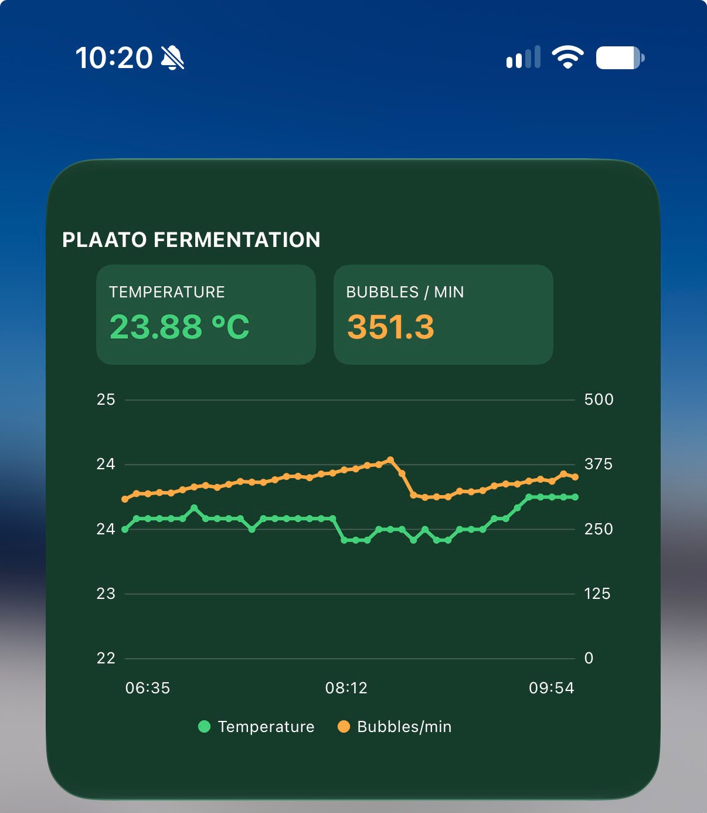

# iPhone widget for Plaato Airlock (Scriptable)

A large home-screen widget that shows your airlock's latest temperature and
bubbles per minute, plus a graph of the last 40 readings.

Community contribution — thanks to the AirlockRevival user who built and shared it.

## Setup

1. Install the free **[Scriptable](https://apps.apple.com/app/scriptable/id1405459188)** app from the App Store.
2. Open Scriptable, tap **+** to create a new script, and paste in the contents of
   [`airlock-widget.js`](airlock-widget.js).
3. Replace `PASTE_YOUR_TOKEN_HERE` with your airlock token (the one from
   [airlock.craftlab.no/get-token](https://airlock.craftlab.no/get-token)).
   If you run your own server, also change `SERVER`.
4. Tap ▶ to test — the widget should open in a preview.
5. On your home screen, long-press → **Edit** → **Add Widget** → **Scriptable** →
   choose the **large** size. Then long-press the widget → **Edit Widget** and pick
   your script.

## Notes

- iOS decides how often widgets refresh — usually every 15–30 minutes, not in real time.
- Your token gives read access to your airlock data. Don't share a copy of the
  script with your token still in it.
- Temperature is shown in °C.
- The widget reads `GET /api/airlocks/{token}/log` (last 24 hours by default).
